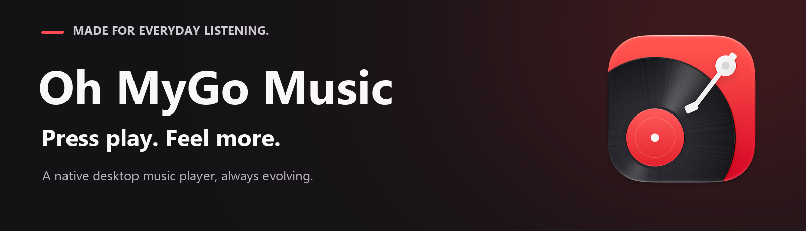
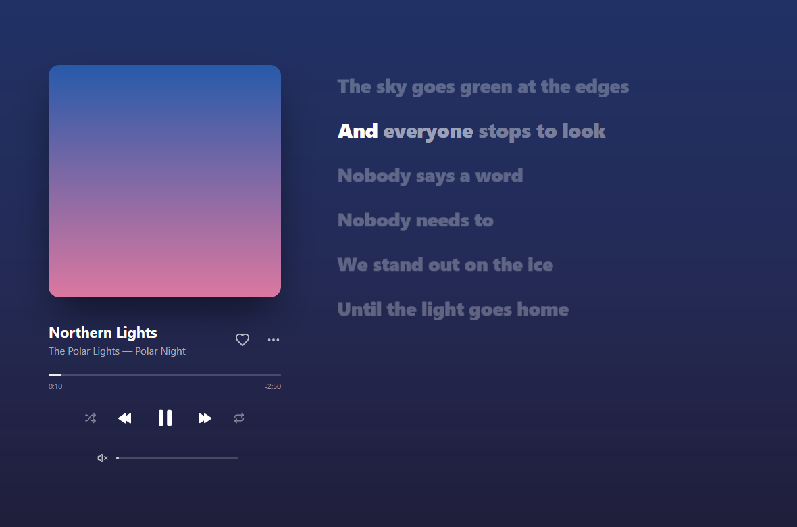
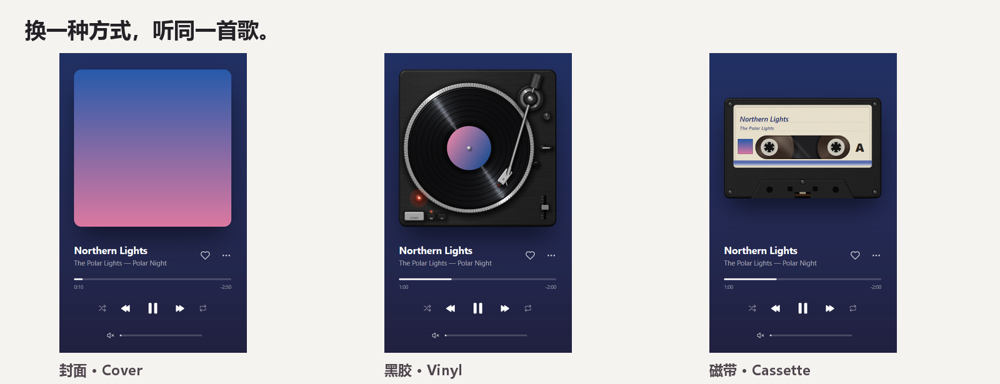
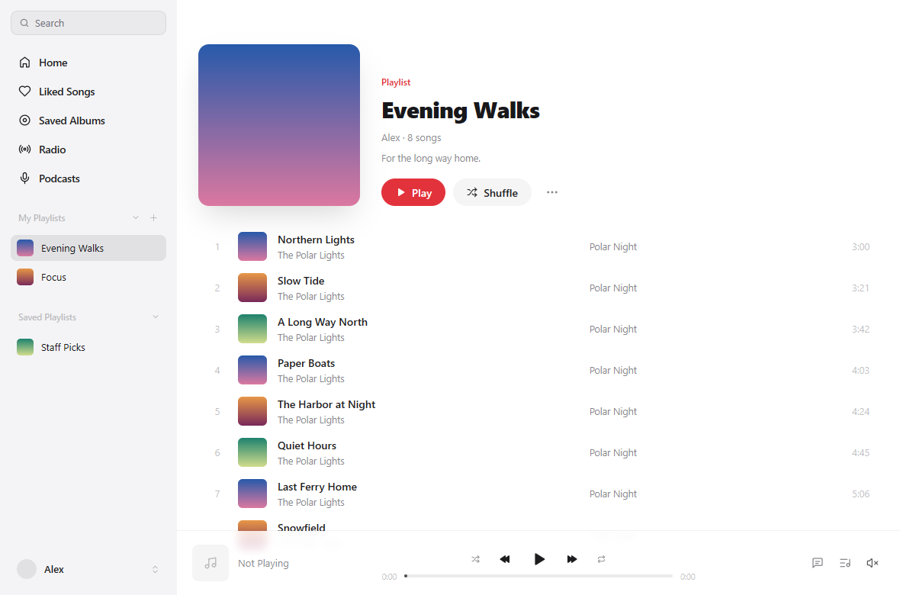

<div align="center">



# Oh MyGo Music

**Press play. Feel more.**

A native desktop music player, made for everyday listening and always evolving.<br />
Start with the music you love. Make room for more.

[简体中文](README.md) · **English**

[Download](https://github.com/zxbdzh/oh-mygo-music/releases/latest) · [Features](#current-experience) · [Quick start](#quick-start) · [Release notes](https://github.com/zxbdzh/oh-mygo-music/releases) · [Report an issue](https://github.com/zxbdzh/oh-mygo-music/issues)

[](https://github.com/zxbdzh/oh-mygo-music/releases/latest)
[](#download)
[](https://github.com/egoist/mygo)
[](LICENSE)

</div>

> Based on [egoist / MyGo Music](https://github.com/egoist/mygo-music), with ongoing improvements and extensions to the native desktop experience. Thank you to the original project and its contributors.



<p align="center"><sub>Interface preview. Songs, artists, and artwork are demo data.</sub></p>

## Current experience

These are some of the experiences available today. See the [release notes](https://github.com/zxbdzh/oh-mygo-music/releases) and [changelog in Chinese](FORK_CHANGELOG.md) for more, and share your ideas in [Issues](https://github.com/zxbdzh/oh-mygo-music/issues).

- **Give your music the stage.** Synchronized lyrics, lyric stages, a cover wall, and cover, vinyl, and cassette player styles.
- **Keep listening while you work.** Windows global shortcuts for playback, track changes, volume, mute, liking a song, and showing or hiding the window. Record your own bindings and see shortcut conflicts.
- **Keep your collection close.** Play local audio with tags, artwork, and `.lrc` lyrics. Browse tracks, albums, and artists, and manage playlists and liked songs.
- **Make it your own.** Plugins add music sources, podcasts, stations, and pages. Install them from GitHub, a local folder, or a ZIP file.
- **Take care of the listening details.** Audio caching, fades on pause and seek, loudness normalization, and session restore.
- **Feel at home on the desktop.** A native interface built with Go and [MyGo](https://github.com/egoist/mygo), with tray support and English and Simplified Chinese interfaces.

## Download

**[Get the latest release on GitHub →](https://github.com/zxbdzh/oh-mygo-music/releases/latest)**

Installers and archives are currently available for **Windows x64 and ARM64**. The latest release page is the source of truth for available platforms, architectures, and versions.

| Your device | Choose on the release page |
| --- | --- |
| Most Intel / AMD Windows PCs | An `.exe` installer containing `amd64`, or the matching `.tar.gz` archive |
| Windows on ARM | An `.exe` installer containing `arm64`, or the matching `.tar.gz` archive |

If you are switching from the original project, install Oh MyGo Music manually first. Subsequent updates come from this repository.

## Quick start

1. **Install the player.** Pick the Windows installer for your architecture above.
2. **Add music.** Go to **Settings → Plugins → Local Files → Add Folder…**, choose your music folder, let it scan, and return to the main view to play a track. For another music source, install and enable its plugin in **Settings → Plugins**, complete any sign-in or configuration, then switch to that source in the main view.
3. **Make playback easier.** Enable global shortcuts in **Settings → Shortcuts**, then customize the bindings to suit you.

Global shortcuts are off by default. Once enabled, they work while the player is running, including when its window is hidden. They stop working when you quit the app.

<details>
<summary><strong>Default shortcuts</strong></summary>

| Action | Default shortcut |
| --- | --- |
| Play / pause | `Ctrl + Alt + P` |
| Previous / next track | `Ctrl + Alt + ←` / `Ctrl + Alt + →` |
| Volume up / down | `Ctrl + Alt + ↑` / `Ctrl + Alt + ↓` |
| Mute / restore volume | `Ctrl + Alt + M` |
| Like / unlike | `Ctrl + Alt + L` |
| Show / hide the window | `Ctrl + Alt + H` |

Disable individual bindings, record new ones, or restore the defaults.

</details>

## The same song, a different way to listen



From immersive lyrics to a retro player, give a familiar song a different atmosphere.

<details>
<summary><strong>Explore the playlist view</strong></summary>



</details>

## Plugins

Open **Settings → Plugins** and click **+** to install a plugin from GitHub, a local folder, or a ZIP file. Plugins can provide accounts, search, playlists, lyrics, podcasts, stations, and more. Available features depend on each plugin.

The [original project's plugin directory](https://mygo-music.egoist.dev/plugins) is a place to start and is maintained by the original project. Check plugin requirements before installing; see this project's [latest release notes](https://github.com/zxbdzh/oh-mygo-music/releases/latest) for compatibility information.

Building a plugin? Start with the [demo plugin](examples/demo-plugin). The [plugin development reference](PLUGIN_DEVELOPMENT.md) covers APIs, setting controls, translations, permissions, and publishing.

<details>
<summary><strong>Supported audio formats</strong></summary>

MP3, FLAC, Ogg Vorbis, WAV, and supported ALAC, FLAC, or AAC audio in `.m4a` / `.aac`. Local tags, album artwork, and `.lrc` lyrics are supported.

</details>

<details>
<summary><strong>Build from source</strong></summary>

See [go.mod](go.mod) for the required Go version.

```bash
git clone https://github.com/zxbdzh/oh-mygo-music.git
cd oh-mygo-music
go tool mygo dev       # Run in development
go tool mygo build     # Build app packages
go test ./internal/... # Run tests
```

See [development instructions](DEVELOPMENT.md) for more on builds and maintaining the podcast transcription runtime.

</details>

## Make it better together

[Report bugs or suggest features](https://github.com/zxbdzh/oh-mygo-music/issues), or contribute through a [Pull Request](https://github.com/zxbdzh/oh-mygo-music/pulls). When reporting a problem, include the app version, operating system and architecture, and steps to reproduce it.

If it makes your daily listening a little better, consider giving it a **Star** and sharing it with another music lover.

## Credits and license

- [egoist / MyGo Music](https://github.com/egoist/mygo-music) — The original player, interface, and plugin ecosystem.
- [MyGo](https://github.com/egoist/mygo) — The native desktop UI framework.
- [folia-major](https://github.com/chthollyphile/folia-major) — The reference for lyric stage animations.

Licensed under **AGPL-3.0**. See [LICENSE](LICENSE).
