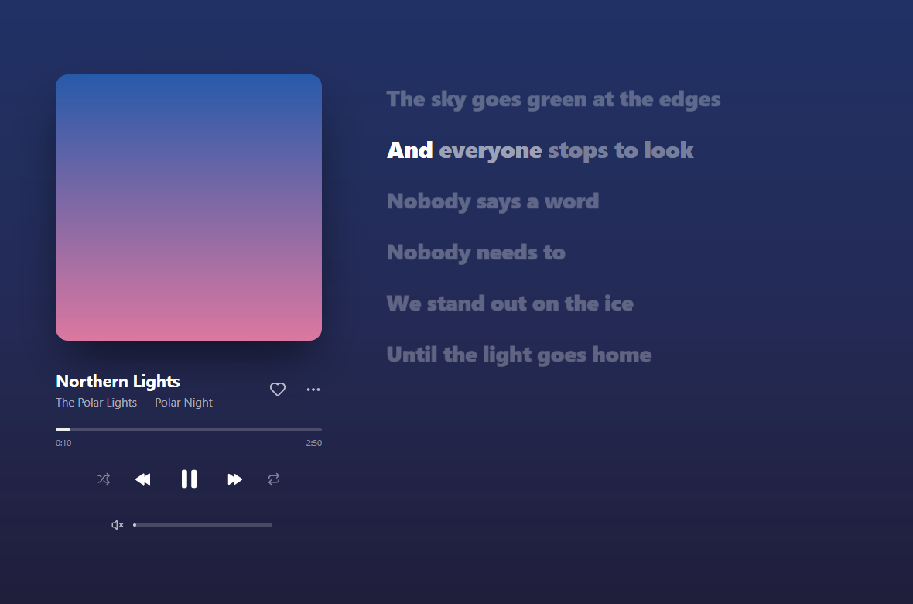
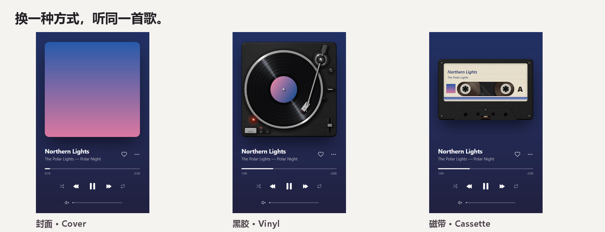
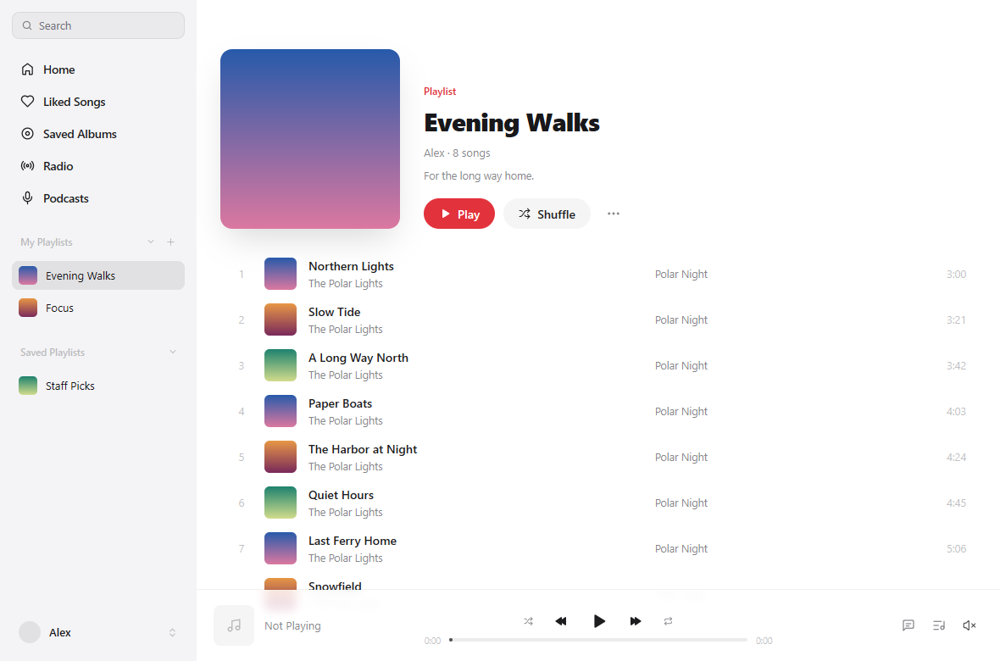

<div align="center">


# Oh MyGo Music

**让音乐，回到主角。**

为日常听歌持续打磨的原生桌面音乐播放器。<br />
从熟悉的音乐收藏出发，让每一次播放都有更多可能。

**简体中文** · [English](README.en.md)

[下载最新版本](https://github.com/zxbdzh/oh-mygo-music/releases/latest) · [当前体验](#当前体验) · [快速开始](#快速开始) · [更新记录](FORK_CHANGELOG.md) · [反馈问题](https://github.com/zxbdzh/oh-mygo-music/issues)

[](https://github.com/zxbdzh/oh-mygo-music/releases/latest)
[](#下载)
[](https://github.com/egoist/mygo)
[](LICENSE)

</div>

> 项目源自 [egoist / MyGo Music](https://github.com/egoist/mygo-music)，在原生桌面体验的基础上持续改进与扩展。感谢原项目与贡献者。



<p align="center"><sub>界面示例；歌曲、歌手与封面均为演示数据。</sub></p>

## 当前体验

这里展示当前版本的一部分体验，更多变化见[更新记录](FORK_CHANGELOG.md)和[发行说明](https://github.com/zxbdzh/oh-mygo-music/releases)。欢迎在 [Issues](https://github.com/zxbdzh/oh-mygo-music/issues) 分享你的使用感受与新想法。

- **把听歌变成一种享受。** 同步歌词、歌词舞台、封面墙，以及封面、黑胶与磁带三种播放器样式。
- **做其他事，也能随手控歌。** Windows 全局快捷键支持播放／暂停、前后切歌、音量、静音、收藏和窗口显隐，可录制、自定义，并提示冲突。
- **把熟悉的音乐收藏留在手边。** 播放本地音频，读取标签、封面与 `.lrc` 歌词，按歌曲、专辑、歌手浏览，也能管理歌单和收藏。
- **按你的需要扩展。** 通过插件接入更多音乐来源、播客、电台与页面；支持从 GitHub、本地目录或 ZIP 安装。
- **照顾每一次播放。** 音频缓存、暂停与跳转时的淡化、响度归一化，以及播放状态恢复。
- **保留原生桌面体验。** 主界面由 Go 与 [MyGo](https://github.com/egoist/mygo) 渲染，提供托盘与中英文界面。

## 下载

**[前往 GitHub Releases 下载最新版本 →](https://github.com/zxbdzh/oh-mygo-music/releases/latest)**

目前提供 **Windows x64 与 ARM64** 安装包及压缩包。平台、架构和版本以最新发行页为准。

| 你的设备 | 在发行页中选择 |
| --- | --- |
| 大多数 Intel / AMD Windows 电脑 | 名称含 `amd64` 的 `.exe` 安装包，或对应的 `.tar.gz` 压缩包 |
| Windows ARM 设备 | 名称含 `arm64` 的 `.exe` 安装包，或对应的 `.tar.gz` 压缩包 |

首次从原项目切换，请手动安装 Oh MyGo Music；后续更新从本仓库获取。

## 快速开始

1. **装好播放器。** 从上方选择对应架构的 Windows 安装包。
2. **添加音乐。** 在「设置 → 插件 → 本地文件」点击「添加文件夹…」，选中存放音乐的目录，扫描后回到主界面选歌播放。使用其他音乐来源时，先在「设置 → 插件」安装并启用对应插件，按提示完成登录或配置，再回到主界面切换到对应来源。
3. **让它更顺手。** 在「设置 → 快捷键」开启全局快捷键，再按自己的习惯修改键位。

全局快捷键默认关闭，开启后在播放器运行期间生效；窗口隐藏时仍可控歌，退出程序后失效。

<details>
<summary><strong>查看默认快捷键</strong></summary>

| 操作 | 默认快捷键 |
| --- | --- |
| 播放 / 暂停 | `Ctrl + Alt + P` |
| 上一首 / 下一首 | `Ctrl + Alt + ←` / `Ctrl + Alt + →` |
| 增大 / 减小音量 | `Ctrl + Alt + ↑` / `Ctrl + Alt + ↓` |
| 静音 / 恢复音量 | `Ctrl + Alt + M` |
| 收藏 / 取消收藏 | `Ctrl + Alt + L` |
| 显示 / 隐藏主窗口 | `Ctrl + Alt + H` |

每项都可以单独停用；也可以录制新键位或恢复默认设置。

</details>

## 换一种方式，听同一首歌



从沉浸歌词到复古播放器，让熟悉的歌多一点现场感。

<details>
<summary><strong>看看歌单界面</strong></summary>



</details>

<a id="plugins"></a>

## 插件

打开「设置 → 插件」，点击 **+**，可以从 GitHub 仓库、本地目录或 ZIP 安装插件。插件可以提供账号、搜索、歌单、歌词、播客、电台等能力，具体以插件实现为准。

可从[原项目的插件目录](https://mygo-music.egoist.dev/plugins)找起，该目录由原项目维护。安装前请核对插件要求，具体兼容性以当前版本的[发行说明](https://github.com/zxbdzh/oh-mygo-music/releases/latest)为准。

想开发插件？从[示例插件](examples/demo-plugin)开始，完整的接口、设置控件、国际化、权限和发布说明见[插件开发文档](PLUGIN_DEVELOPMENT.md)。

<details>
<summary><strong>支持的音频格式</strong></summary>

MP3、FLAC、Ogg Vorbis、WAV，以及 `.m4a` / `.aac` 中受支持的 ALAC、FLAC 或 AAC 音频。支持读取本地标签、专辑封面和 `.lrc` 歌词。

</details>

<a id="build"></a>

<details>
<summary><strong>从源码构建</strong></summary>

项目的 Go 版本要求见 [go.mod](go.mod)。

```bash
git clone https://github.com/zxbdzh/oh-mygo-music.git
cd oh-mygo-music
go tool mygo dev       # 开发运行
go tool mygo build     # 构建发行包
go test ./internal/... # 运行测试
```

更多构建与播客转写运行库维护说明见[开发文档](DEVELOPMENT.md)。

</details>

## 一起把它做得更好

欢迎提交[问题反馈与功能建议](https://github.com/zxbdzh/oh-mygo-music/issues)，或通过 [Pull Request](https://github.com/zxbdzh/oh-mygo-music/pulls) 参与改进。反馈问题时请附上版本、系统与架构，以及复现步骤。

如果它让你的日常听歌更舒服，欢迎点个 **Star**，也分享给同样喜欢音乐的朋友。

## 致谢与许可

- [egoist / MyGo Music](https://github.com/egoist/mygo-music) — 上游播放器、界面与插件生态。
- [MyGo](https://github.com/egoist/mygo) — 原生桌面界面框架。
- [folia-major](https://github.com/chthollyphile/folia-major) — 歌词舞台动画的参考来源。

本项目基于 **AGPL-3.0** 开源，详见 [LICENSE](LICENSE)。
